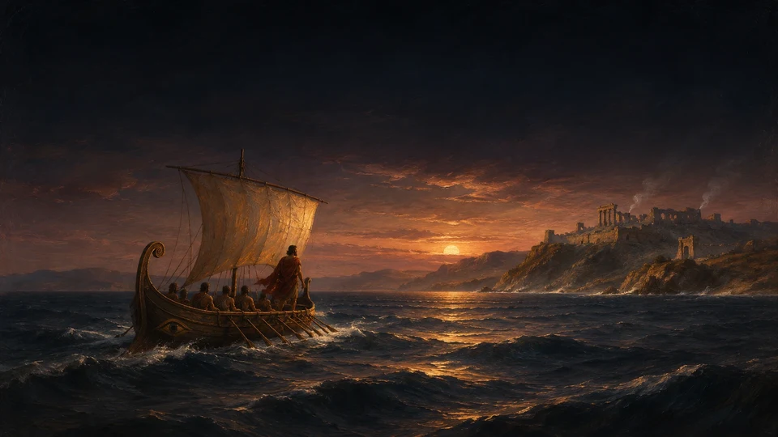

# Odyssey for Omarchy



Wine-dark plum recalls Homer’s sea. Fired-clay borders and bronze highlights evoke Greek pottery and metalwork, while olive green nods to Ithaca. Sailcloth text carries the warm light of the paintings into the interface. Three original illustrated wallpapers trace Odysseus’s journey home.

1. **Departure from Troy** — The galley sails out at dusk.
2. **The Sirens** — Moonlight and sea foam mark the passage through jagged cliffs.
3. **Return to Ithaca** — Amber light falls on the island at daybreak.

Omarchy generates Hyprland, terminal, and supported app colors from `colors.toml`. The bar, launcher, and menu styling live in `shell.toml`.

## Installation

From the project folder, install a new copy and select it with these commands.

```sh
theme_dir="$HOME/.config/omarchy/themes/odyssey"
mkdir -p "${theme_dir%/*}"
mkdir "$theme_dir" &&
  cp -R colors.toml shell.toml preview.webp backgrounds "$theme_dir/" &&
  omarchy theme set odyssey
```

Run `omarchy theme bg next` to continue the journey or `omarchy theme bg-switcher` to select a scene.

## Animated openings

Each chapter has a 4.4-second camera pullback that settles into the matching still wallpaper. Omarchy plays the selected chapter’s intro when switching into Odyssey from another theme, with wallpaper intros and Hyprland animations enabled. Use `omarchy theme bg intro status` to check the intro setting.

The silent clips live in `backgrounds/intros/` and share their filenames, apart from the extension, with the still wallpapers.
